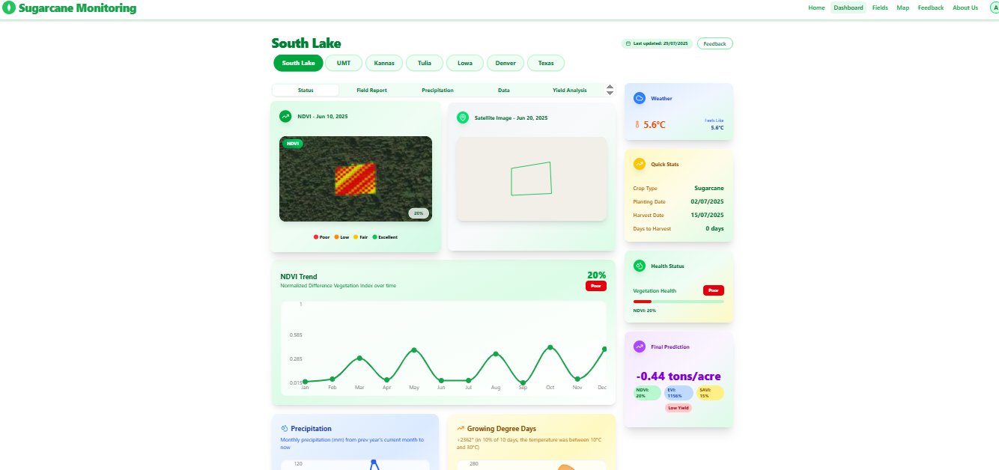

# Syed Muhammad Abbas Zaidi | Portfolio

Personal portfolio website for a .NET and Python developer and 2025 computer science graduate. It showcases business software, machine learning projects and professional experience, and includes a downloadable CV.

**Live site:** https://your-project.vercel.app *(replace after deploying)*



## Features

- Hero section with a portrait and a CV download button
- Project showcase with real screenshots
- Tabbed screenshot gallery for the Sugarcane Monitoring project
- Experience, education and skills sections
- One-page ATS-friendly CV served as a PDF
- Automatic light and dark mode
- Responsive layout for phones, tablets and desktops
- Respects reduced-motion settings and has visible keyboard focus

## Projects featured

| Project | Stack | Description |
| --- | --- | --- |
| InvoicePro | .NET, C#, SQL Server | Invoicing and business management system for a distribution business |
| Sugarcane Yield Prediction | Python, LSTM, remote sensing | Satellite-based crop monitoring and yield prediction dashboard (final year project) |
| Kidney Stone and Tumor Detection | Python, TensorFlow, OpenCV, CNN | Classifies CT and X-ray images to find kidney stones and tumors |

## Tech stack

- [Next.js 14](https://nextjs.org/) (App Router)
- React 18
- Plain CSS with custom properties
- `next/font` for Fraunces and Instrument Sans
- Deployed on [Vercel](https://vercel.com/)

## Project structure

```
.
├── app/
│   ├── layout.js        # Fonts and metadata
│   ├── page.js          # All page sections
│   └── globals.css      # Styles and theme colors
├── components/
│   └── SugarcaneGallery.js   # Client-side screenshot tabs
├── public/
│   ├── images/          # Portrait and project screenshots
│   └── Syed_Muhammad_Abbas_Zaidi_CV.pdf
├── next.config.js
└── package.json
```

## Getting started

You need Node.js 18.17 or newer.

```bash
git clone https://github.com/abbas2562/abbas-portfolio.git
cd abbas-portfolio
npm install
npm run dev
```

Open http://localhost:3000 in your browser.

To create and test a production build:

```bash
npm run build
npm start
```

## Customizing

- **Text and projects:** edit `app/page.js`.
- **Colors and layout:** edit the variables at the top of `app/globals.css`.
- **Screenshots:** replace the files in `public/images/`, keeping the same names.
- **CV:** overwrite `public/Syed_Muhammad_Abbas_Zaidi_CV.pdf`. The download buttons will serve the new file.
- **Email and links:** change the `EMAIL` constant and the GitHub and LinkedIn links in `app/page.js`.

## Deploying to Vercel

1. Push this repository to GitHub.
2. Go to [vercel.com/new](https://vercel.com/new) and import the repository.
3. Keep the default settings. Vercel detects Next.js automatically.
4. Click **Deploy**.

Every push to the main branch redeploys the site.

## Contact

- Email: smabbas2562@gmail.com
- GitHub: [github.com/abbas2562](https://github.com/abbas2562)
- LinkedIn: [linkedin.com/in/muhammad-abbas](https://linkedin.com/in/muhammad-abbas)

## License

All code, text, images and the CV in this repository are © 2026 Syed Muhammad Abbas Zaidi. Please do not reuse the personal content (photo, CV, project screenshots) without permission. You're welcome to take inspiration from the layout.
